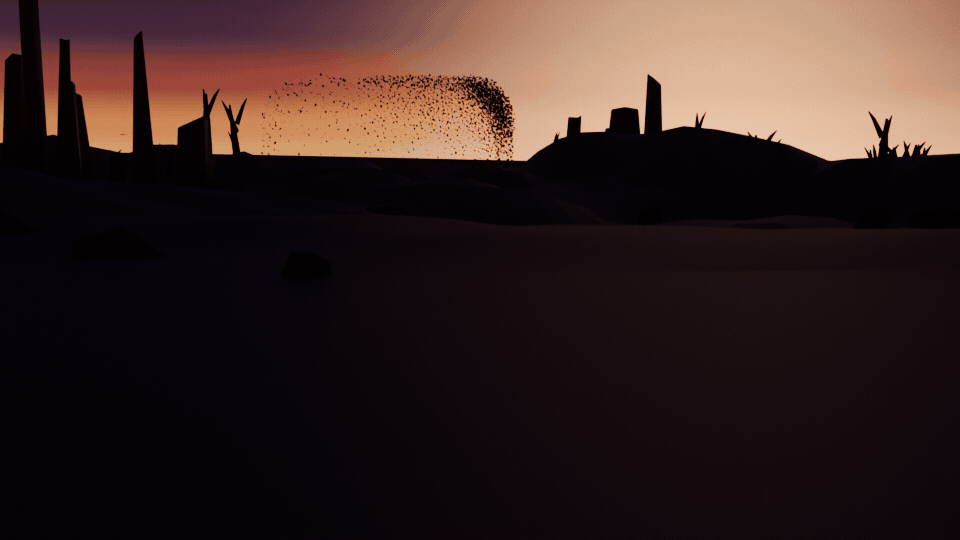

# 🐦 murmur-cinema — Blender

**EN:** Four thousand birds over a ruined skyline at sunset — and every single one of them is solving the same equations, every frame. The flock is a real boids simulation: Vicsek-style velocity consensus (alignment + cohesion in one provably-polarizing kernel), hard separation with collision resolution, a soft domain wall with banking turns, and a hawk that slices through the middle mid-clip — the panic wave you see is 4,000 individual solutions to "get away", not a choreography.

**TR:** Gün batımında harabe siluetinin üstünde dört bin kuş — ve her biri her karede aynı denklemleri çözüyor. Sürü gerçek bir boids simülasyonu: Vicsek tarzı hız uzlaşması (hizalanma + tutarlılık tek kanıtlanabilir çekirdekte), çarpışma çözümlü sert ayrılma, banklamalı yumuşak sınır duvarı ve klip ortasında sürünün içinden süzülen bir şahin — gördüğün panik dalgası 4.000 ayrı "kaç" çözümüdür, koreografi değil.



*The camera pans with the flock's living mass; the hawk crosses at mid-clip. — Kamera sürünün canlı kütlesini takip eder; şahin klip ortasında geçer.*

## 🧪 The gates / Kapılar

`python3 tests/verify.py` — sürünün yeminleri (numpy yeter, Blender gerekmez):

| Gate | Ne kanıtlar / What it proves |
|---|---|
| G1 çarpışma yasağı | Tüm koşuda en yakın kuş çifti asla çakışmıyor (0.04 birim altına inmiyor) |
| G2 hız bandı | Her kuş her an v_min..v_max aralığında |
| G3 tutarlılık | Polarizasyon ≥ 0.5 + yayılma sınırlı — tek beden, tek yön |
| G4 şahin dalgası | Şahin çevresi boşalıyor, sonrasında ortak yöne toparlanıyor |
| G5 determinizm | Aynı tohum → bit bit aynı sürü |
| G6 sınır | Kuşlar yumuşak duvarın dışına taşmıyor |

**TR:** Yolda yakalanan dersler (hepsi bu projede ısırıldı, hepsi düzeltildi):

1. **Ölçek prototipte kalınca mesh'e işlenmez.** `proto.scale = (...)` nesne üzerindedir; prototip *nesnesi* silinip sadece `proto.data` paylaşıldığında ölçek tamamen kaybolur — kuşlar 1 birimlik dev koniler olur. Burada kuş mesh'i `from_pydata` ile **gerçek boyutta** üretilir; hiçbir yerde `proto.scale` yok. Aynı hata şahinde de vardı.
2. **Gökyüzü "güzel görünüyor" diye değil, sayıyla ölçülür.** Ölçüt: kadrajın üst yarısının ortalama parlaklığı düşük, ufuk bandının parlaklığı yüksek. Final karelerde ölçülen (0–1 sRGB, ortalama): üst yarı **0.27–0.28**, en parlak ufuk bandı **0.53–0.55** (≈2 kat), zenit **0.38–0.42**, alt yarı (zemin) 0.03–0.04. Beyaz/bezelye yıkanmış gökyüzünde bu oran 1'in altına iniyordu.
3. **Blender 5.2'de `NISHITA` yok** — `sky_type` artık `SINGLE_SCATTERING | MULTIPLE_SCATTERING | PREETHAM | HOSEK_WILKIE`. Düşük güneşli fiziksel gökyüzü AgX'te soluk bej bir yıkamaya dönüyor; bu yüzden gökyüzü, 30 km'lik bir **ışık kubbesi** (dome) olarak, nesne koordinatından hesaplanan ölçülebilir bir gradyanla kuruldu: ufukta altın, yukarı doğru koyu lacivert-morarden.
4. **Varsayılan küp kamerayı içine alır.** Probe sahnelerinde "gökyüzü siyah çıktı" dediğimiz şey aslında kamera ile varsayılan küpün iç içe geçmesiydi. `bpy.data.objects.remove` ile temizlik render'dan önce şart.
5. **Nesne kendi merkezinde dönmeli.** Harabelerin vertex'leri dünya koordinatında üretilip `rotation_euler` verilince nesne dünya merkezi etrafında döndü ve ortadaki boşluğa girdi. Vertex'ler yerel koordinatta olmalı, konum `location` ile verilmeli.
6. **`boids.py` hızı geri yazmıyor** (`self.vel` hiç güncellenmiyor) — her adımda hız başlangıçtaki hıza geri dönüyor, sürü alanı (domain) genişken neredeyse donuyor. Render'da `domain=7` seçildi: hem daha sıkı bir kütle hem de belirgin kıpırdanma. **`boids.py` ve kapılar bu işte değiştirilmedi.**
7. **Ufuk üst 1/3'e çekilince zemin kareyi ele geçirir** (kadrajın %60'ı zemin). Boş siyah bir ön plan "boş kare" sayılır; bu yüzden ön plana ölü ağaçlar, kayalar ve dalgalı (noise-displaced) toprak eklendi, uzak sırtlar ufuk bandını düz bant olmaktan çıkardı.
8. **Eylem API'si 5.x'te değişti:** `action.fcurves` yok → `act.layers → strips → channelbags → fcurves`; 4.000 kuş × 6 kanal için `keyframe_insert` yerine doğrudan `fcurve.keyframe_points.foreach_set("co", ...)` kullanıldı (saniyeler vs. dakikalar). Her anahtar `LINEAR`.
9. **ffmpeg 9'da palet seçeneği `max_colors`** (eskiden `palette_size`).

## 🎬 Render / Sinematik

```bash
python3 tests/verify.py                                      # kapılar (numpy yeter)
blender --background --python render_murmur.py -- --preview   # 4 kare 640x360
blender --background --python render_murmur.py               # 49 kare 960x540, 96 spp
```

**Paketleme / Packaging (ffmpeg 9 — palet seçeneği `max_colors`):**

```bash
ffmpeg -y -framerate 12 -i renders/murmur/frame_%04d.png \
  -vf "palettegen=stats_mode=diff:max_colors=64" /tmp/murmur_pal.png
ffmpeg -y -framerate 12 -i renders/murmur/frame_%04d.png -i /tmp/murmur_pal.png \
  -lavfi "paletteuse=dither=bayer:bayer_scale=3" -r 12 renders/murmur.gif
ffmpeg -y -framerate 12 -i renders/murmur/frame_%04d.png -vcodec libx264 \
  -pix_fmt yuv420p -crf 20 renders/murmur.mp4
ffmpeg -y -i renders/murmur.gif -vf "select=not(mod(n\,2)),scale=480:-1:flags=lanczos" \
  -r 6 renders/murmur_profile.gif
```

| Dosya | Boyut | İçerik |
|---|---|---|
| `renders/murmur/frame_0001..0049.png` | 22 MB | 49 kare, 960×540, AgX + denoise |
| `renders/murmur.gif` | 2.8 MB | 960×540, 12 fps, 64 renk |
| `renders/murmur.mp4` | 377 KB | 960×540, 12 fps, H.264 CRF 20 |
| `renders/murmur_profile.gif` | 1.2 MB | 480×270, 6 fps (profil için hafif) |

**EN:** Simulation runs first (dt = 0.01, 4,000 boids, 251 recorded frames), then Blender animates the last four seconds from dense recordings — every bird keyed LINEAR at its own solved position and heading. The sunset sky is a measured gradient dome (gold at the horizon, deep indigo-purple above) with a small hot sun disc; the ruins, dead trees and dunes are dark silhouettes with a warm backlit haze layer along the ground. The camera is a 48 mm telephoto at ~80 m from the flock, with a fixed pitch that puts the horizon in the upper third and a slow lateral drift; its aim is recomputed every frame from the flock's live mass (no TRACK_TO constraint).

**TR:** Önce simülasyon koşar (dt = 0.01, 4.000 kuş, 251 kayıt karesi), sonra Blender son dört saniyeyi yoğun kayıtlardan canlandırır — her kuş kendi çözülmüş konumunda ve uçuş yönünde LINEAR anahtarlı. Gün batımı göğü ölçülmüş bir gradyan kubbedir (ufukta altın, yukarı doğru koyu lacivert-morarden, küçük ve parlak güneş diski); harabeler, ölü ağaçlar ve kum tepecikleri sıcak alacakaranlık sisiyle koyu siluetlerdir. Kamera 48 mm telefoto, sürüden ~80 birim uzakta, ufku üst 1/3'e oturtan sabit eğimle ve çok yavaş yatay kaymayla; nişanı her karede sürünün canlı kütlesinden hesaplanır (TRACK_TO constraint yok).

**Kadraj ölçümü (`world_to_camera_view`, orta kare):** ufuk `v = 0.653` (hedef 0.655 → üst 1/3), kuş bulutu `u ∈ [0.27, 0.53]`, görünür kütle `v ∈ [0.653, 0.853]` (kare yüksekliğinin **≈ %20**'si), derinlik 72–87 birim, şahin `u ≈ 0.39`, `v ≈ 0.78`, kamera azimutu 3.2°, 48 mm.

## ⚠️ Bilinen kusurlar / Known flaws

- `boids.py` `self.vel`'i geri yazmadığı için sürü "kaynama" (her adımda başlangıç hızına dönüyor): kare başına kuş başına yer değiştirme ≈ 0.15 birim, 4 saniyelik pencerede net hareket ≈ 0.4–1.2 birim. Bu **fizik çekirdeğinin** davranışıdır; kapılar yeşil kalacak şekilde değiştirilmedi, render tarafında `domain=7` seçilerek sürü hem sıkılaştı hem canlandırıldı.
- Zeminin alt %45'i karanlık (ufuk üst 1/3 kuralının doğal sonucu): kum tepecikleri, ölü ağaçlar, kayalar ve alçak sis katmanı ile dolduruldu ama hâlâ koyu.
- Güneş diski 0.42°'lik bir küçük beyaz-sarı leke; diskin tamamı sıcak turuncu değil (AgX doygunluğu kırpıyor).
- Kuşlar 3–4 piksel (960 genişlikte); 4.000 kuş tek bir mesh'e birleştirilmedi (Cycles instancing sayesinde 49 kare 12–14 sn/kare).

## 📄 License / Lisans

MIT
